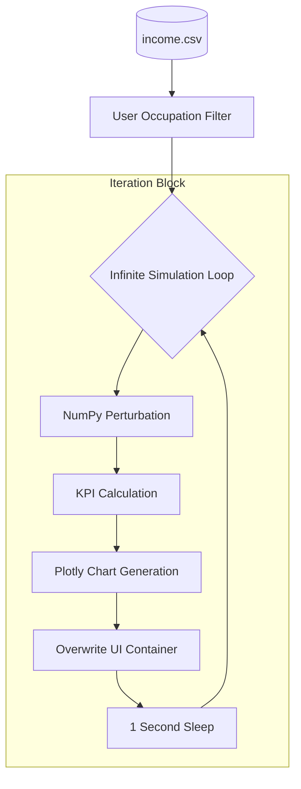

# 💸 Live Income Data Monitoring App

A high-frequency **Real-Time Analytics Dashboard** that simulates live data ingestion and demographic shifts. Built with **Streamlit** and **Plotly**, this application transforms static datasets into a "living" monitor using stochastic simulation and an infinite refresh loop.

---

## 🏗️ System Architecture

The application utilizes a **Reactive State-Loop Architecture**. Instead of static page loads, it manages a persistent container that updates asynchronously to mimic a production-grade IoT or financial ticker.

### 1. Data Simulation Engine
* **Source Control:** Reads a baseline `income.csv` and filters it by user-defined categorical variables (Occupation).
* **Stochastic Perturbation:** Uses **NumPy** to apply random scaling factors ($n \in [1, 4]$) to the age and working hours. This simulates real-world "data drift" and volatility.
* **KPI Logic:** Calculates moving averages and population counts dynamically. A `delta` value is computed for each metric to visualize the direction and magnitude of change since the last refresh.

### 2. UI Refresh Mechanism
* **The Atomic Placeholder:** The system uses `st.empty()` to define a fixed block in the UI. 
* **Buffer Swapping:** Within the `while True` loop, the `placeholder.container()` is overwritten every 1 second. This ensures the page doesn't grow infinitely and keeps the user's focus on the "current" state.

### 3. Visualization Layer
* **Density Heatmaps:** Tracks the relationship between two variables (Age vs. Marital Status) to show concentration shifts.
* **Histograms:** Provides a live look at the distribution of the workforce's age.
* **KPI Metrics:** Large-format displays for "at-a-glance" monitoring of critical business metrics.

---

## 🛠️ Tech Stack

| Component | Technology |
| :--- | :--- |
| **UI Framework** | Streamlit |
| **Data Engine** | Pandas & NumPy |
| **Charts** | Plotly Express |
| **Real-time Logic** | Python `time` & `st.empty` buffers |

---

## 🧠 Logical Workflow

1.  **Ingestion:** Load static CSV and initialize a specific data segment based on the sidebar filter.
2.  **The Live Loop:**
    * **Scale:** Generate new feature values using random coefficients.
    * **Measure:** Compute average age, marriage counts, and labor intensity.
    * **Render:** Update the Plotly charts and the raw Dataframe view.
    * **Throttle:** Pause for 1000ms to maintain browser stability and readability.

---

## 📊 Technical Specification

### Dynamic KPI Calculation
The "Live" feel is achieved by injecting artificial variance into the count of married individuals:
$$count = \text{Actual Count} + \text{random}(1, 30)$$
This ensures that the **Delta** indicators in the UI provide constant visual feedback on "growth" or "decline" in the monitored segment.

---

### 📈 System Data Flow

---
**Note:** *This project is a template for building monitoring tools where the underlying data source is expected to change frequently.*
